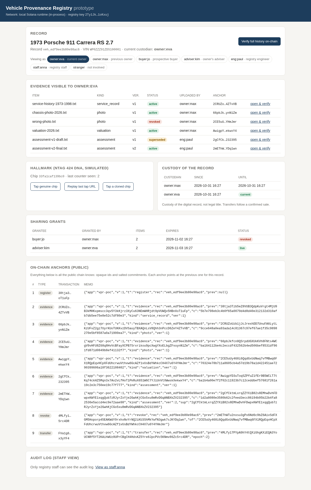
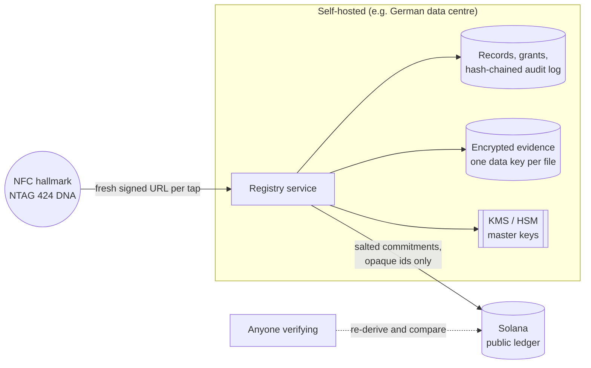
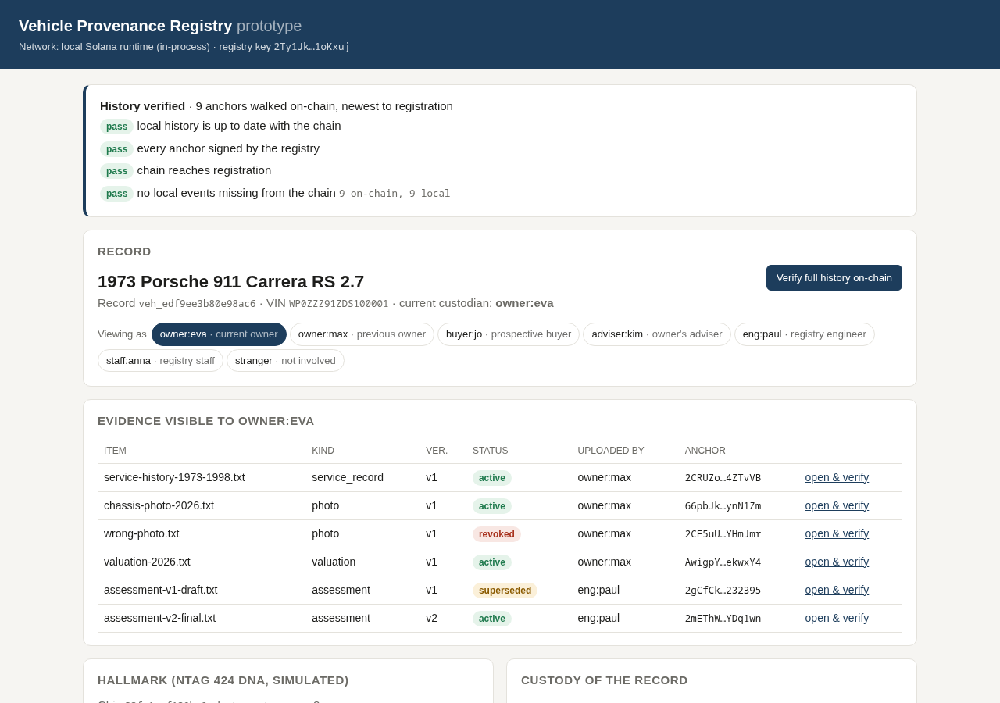
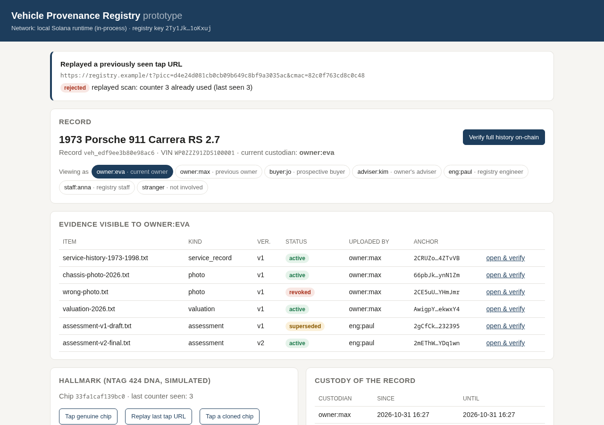
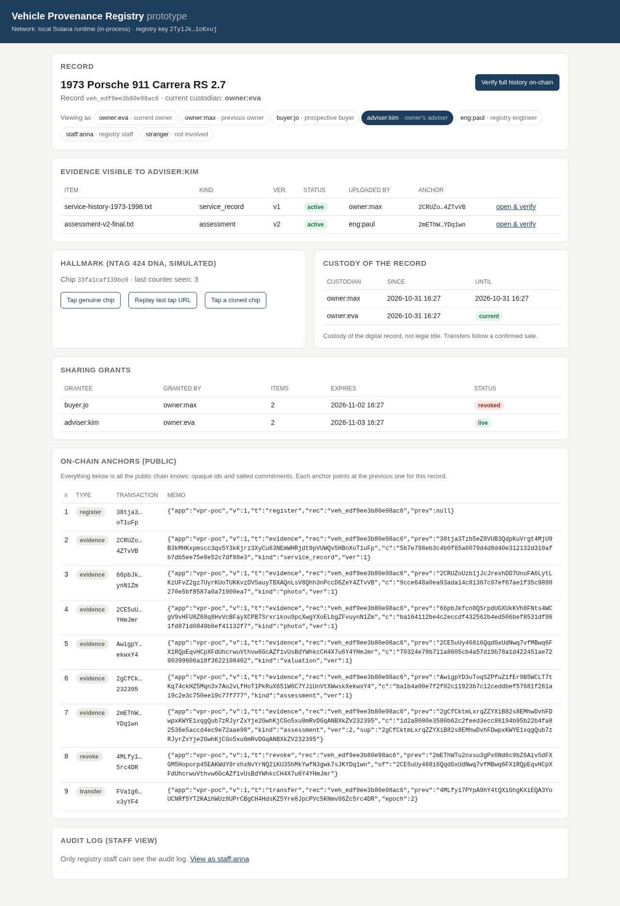
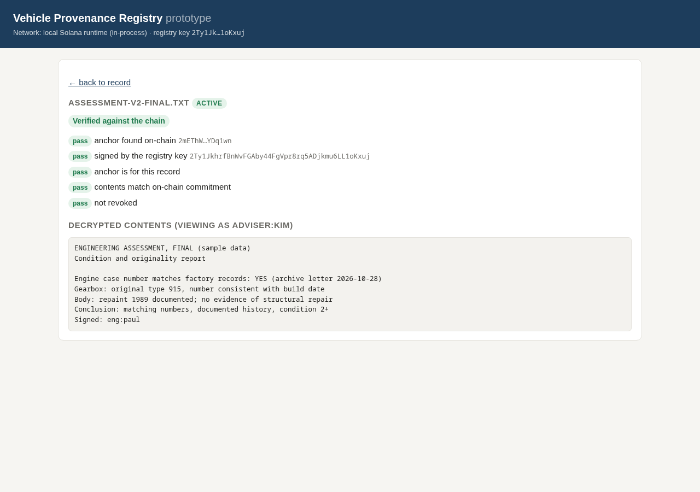
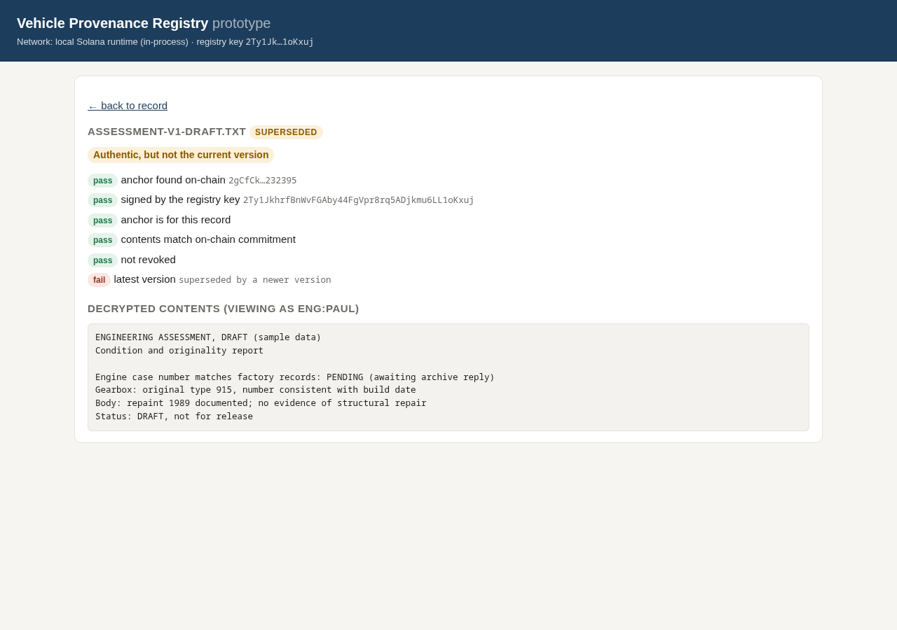
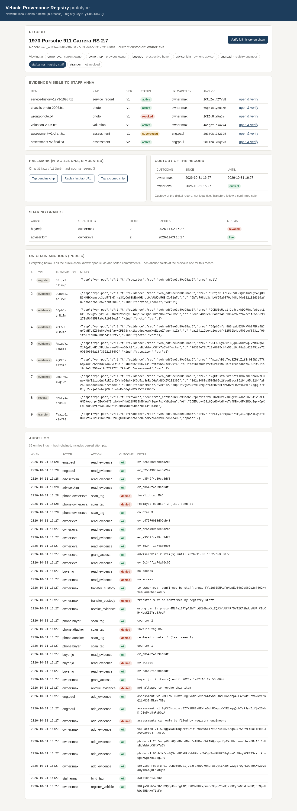
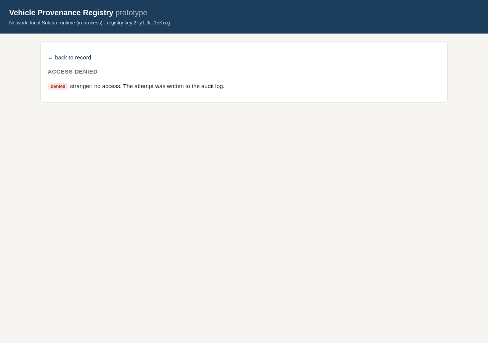

# Vehicle Provenance Registry (prototype)

A small prototype that tests one way of linking a collectible vehicle's physical hallmark to a confidential digital record, with tamper-evident history on a public blockchain and owner-controlled sharing.

It is a sketch to think with, not a product. It answers "does this approach hold up, and where are the hard parts?" in about 1,700 lines of TypeScript, with 26 automated tests.



A 70-second walkthrough with captions is in [docs/walkthrough.webm](docs/walkthrough.webm) (opens in any browser), and the full terminal run is in [docs/demo-output-local.txt](docs/demo-output-local.txt).

## What it does

The demo plays one car's lifecycle from start to finish:

1. An owner registers a 1973 Porsche 911. The registry anchors the record on Solana.
2. Staff fit an NFC hallmark (NTAG 424 DNA) and bind it to the record.
3. The owner uploads a service history, photos and a valuation. Each file is encrypted at rest, and only a salted commitment of it goes on-chain.
4. An engineer files an assessment, then a revised version. The owner cannot file, alter or withdraw an assessment.
5. The owner shares two selected items with a prospective buyer for 48 hours. The buyer can open and verify those two and nothing else.
6. Someone taps the hallmark. A genuine tap is accepted; a replayed tap URL and a cloned chip are both rejected.
7. The owner withdraws a photo uploaded by mistake. The withdrawal is anchored, and the reason stays off-chain.
8. The car is sold. Custody of the record moves to the new owner after staff confirmation, and every share made by the previous owner ends.
9. Everything is verified independently against the chain.

## Architecture



Everything confidential stays on infrastructure you control. The public chain receives only opaque record ids, salted commitments and links between events: no names, VINs, documents, valuations or reasons.

## Design decisions

**Evidence off-chain, commitments on-chain.** Documents live encrypted in private storage. For each one, the registry anchors `sha256(salt : sha256(file))`. A bare file hash would let anyone holding a copy of a document confirm it belongs to the registry. The salt prevents that, and it is disclosed only to people allowed to verify.

**Every event links to the previous one.** Each anchor (registration, evidence, revocation, transfer) carries the signature of the previous anchor for that record. Verification walks this chain on-chain from the newest event back to registration and compares it with the local database. It also asks the chain for the registry key's newest anchor on the record, so deleting recent events locally is detected too. A memo written by any other key is ignored. Anyone can write a memo that looks like ours, so the signer is what makes an anchor authoritative.

**Versioning and revocation are new events, never edits.** A revised assessment supersedes the old one and points to it on-chain. A withdrawn item gets a revocation anchor. Verification of an old version still reports it as authentic, but says plainly that it is not current.

**Custody of a record is not legal ownership.** The prototype deliberately says "transfer custody", not "transfer ownership". Title to a vehicle is decided by contract and the registration papers, not by a ledger entry, so the record follows a sale that staff have confirmed, rather than causing one. This is also why it has no tokens. An NFT would invite the reading "whoever holds the token owns the car", which is legally wrong and practically dangerous (a stolen wallet would look like a stolen car).

**Collectors hold no keys.** The registry signs anchors, so owners need no wallet and there is no key-recovery problem for them. The trade-off is that people must trust the registry operator. Public anchoring is what limits that trust: the operator cannot quietly rewrite history, even in its own database.

**Physical link: NTAG 424 DNA "SUN" messages.** A plain NFC tag returns a fixed UID that anyone can copy onto a blank tag. An NTAG 424 DNA returns a new URL on every tap, containing the encrypted UID, a counter that increments inside the chip, and an AES-CMAC computed with a key that never leaves the chip. The server rejects bad MACs (clones), counters it has already seen (replayed URLs) and chips not bound to a record. Each chip's key is derived from a master key and its UID (key diversification), so extracting one chip's key compromises no other chip, and the server stores no per-tag secrets. The implementation reproduces NXP's published example from application note AN12196 exactly (tested).

**What the tag does not solve.** A genuine chip can be removed and attached to a different car. Cryptography cannot detect that. It needs tamper-evident mounting (or the TagTamper variant of the chip, which reports a broken loop), and an engineer's inspection that records where and how the hallmark is fitted. In this design the tag proves "this chip is genuine and unique", and the engineering assessment proves "this chip belongs to this car".

**Sharing is selective, time-limited and revocable.** An owner shares specific items with a specific person until a given time, and can revoke the share at any time. Shares end automatically when custody changes. Every access, including denied attempts and rejected tag scans, goes into a hash-chained audit log.

**Deletion despite an immutable ledger.** Each file has its own data key, wrapped by a master key (envelope encryption). Destroying a file's wrapped key makes every copy unreadable, including copies in backups ("crypto-shredding"). What remains on-chain is a salted commitment that reveals nothing on its own.

## Where a blockchain adds value, and where it doesn't

It adds value as a neutral, timestamped, append-only witness. It lets a third party (a buyer, an insurer, a court) check that a document existed in a given form at a given time, and that the registry has not altered or hidden events since, without trusting the registry's database.

It adds little or nothing for storing documents (cost, privacy, the GDPR right to erasure), for proving legal ownership, for access control, or for proving that a physical object is what its record says. Most of the system's real guarantees come from conventional engineering: encryption, permissions, audit logs, and the inspection process.

Pitfalls: anything written on-chain is public and permanent, so a careless memo is a data leak forever. Tokens create legal ambiguity. Wallet-based ownership creates key-loss and theft problems for users who never asked for them. A ledger proves only that a record was not changed, not that it was true in the first place.

Why Solana here: transactions are cheap (about 0.000005 SOL per anchor) and confirm in seconds. The Memo program needs no custom smart contract, so there is nothing on-chain to audit. The design is chain-agnostic: the same anchors could go to another public chain, or be batched into a single Merkle root per hour to cut cost and on-chain footprint further.

## What is real and what is simulated

| Part | Status |
|---|---|
| Solana anchoring and verification | Real Memo program transactions. Runs against devnet (the public test network), or against an in-process Solana runtime (LiteSVM) that executes the same program. |
| NTAG 424 DNA message format and cryptography | Real algorithm, verified against NXP's published test vector. The chip itself is simulated in software. |
| Encryption, envelope keys, crypto-shredding | Real (AES-256-GCM). Master keys are local files, standing in for a KMS/HSM. |
| Permissions, grants, custody, audit log | Real logic, fully tested. Users are named strings; there is no login. |
| Storage | SQLite and local files. The schema maps directly onto Postgres. |

## What production would add

- Authentication with a self-hosted identity provider (e.g. Keycloak) and attribute-based permissions, such as engineers assigned per record rather than seeing every record.
- Postgres with row-level security for tenant isolation, and master keys in an HSM or self-hosted KMS (e.g. OpenBao).
- An outbox for anchoring, so registry writes never block on the chain and anchors retry if the network is unavailable. Optionally, Merkle batching.
- An independent index of on-chain revocations, so per-item checks don't rely on the local database. (Full-history verification already catches hidden revocations.)
- Real tags, a scanning flow on phones, and a tamper-evident mounting procedure.
- A threat model, dependency scanning in CI, an external penetration test before launch, and a data protection impact assessment (DPIA) under GDPR.

Where I would involve specialists: NFC hardware integration and tag mounting, an external security audit and penetration test, and legal review of the custody and ownership semantics and of GDPR obligations. If the design ever moved value or logic into a smart contract, that contract would need its own audit.

## Running it

Requires Node 22 or later, on macOS or Linux. On Windows, use WSL: the in-process Solana runtime has no native Windows build. Dependencies pass `npm audit` with no known vulnerabilities.

```bash
npm install
npm test                 # 26 tests: crypto vectors, permissions, tag attacks, tamper detection, Solana runtime
npm run demo:local       # full lifecycle on an in-process Solana runtime, no network needed
npm run serve:local      # same, then browse it at http://localhost:7077
```

On Solana devnet (public, so transactions appear in Solana Explorer):

```bash
npm run fund             # prints the registry address; fund it at https://faucet.solana.com (devnet)
npm run demo             # anchors on devnet and prints Explorer links
npm run serve            # browse the devnet record at http://localhost:7077
```

The web view has a "viewing as" switcher, so the same record can be seen as the owner, a previous owner, a buyer, an adviser, an engineer, staff, or a stranger.

## Layout

```
src/
  registry.ts   records, evidence, sharing, custody, tag scans, verification
  chain.ts      Solana anchoring (devnet, in-process runtime, in-memory for tests)
  tag.ts        NTAG 424 DNA SUN decoding, key diversification, simulated chip
  cmac.ts       AES-CMAC (RFC 4493)
  crypto.ts     envelope encryption, commitments
  db.ts         schema
  server.ts     web view
scripts/demo.ts the lifecycle above
test/           unit tests and Solana runtime tests
docs/           screenshots, walkthrough video, demo output
```

## Screenshots

| | |
|---|---|
|  History verified on-chain |  Replayed tap URL rejected |
|  Cloned chip rejected |  Adviser sees only what was shared |
|  Item verified against its commitment |  Superseded version flagged |
|  Staff view with audit log |  Denied access is logged |

---

Built by Adam Hmida Loghmari · [adamloghmari.dev](https://adamloghmari.dev)
